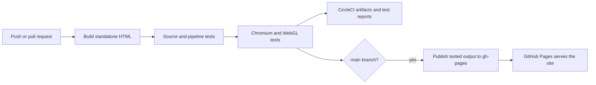

# Wedding venue planner

A static, interactive Three.js venue model. Visitors need only a browser with WebGL. There is no application server, database, paid hosting service, or runtime Node.js dependency.

The production build is a self-contained `dist/index.html` with inline HTML, CSS, JavaScript and the pinned Three.js library. It works at a GitHub Pages project URL and can also be downloaded and opened locally. Layout changes save in each visitor's own browser; they are **not shared between visitors**. Use Save layout / Load saved layout to exchange design choices.

## Local work

Use Node.js 22 or newer:

```sh
npm ci
npx playwright install chromium
npm test
npm run serve
```

Open the local URL printed by the server. `npm run build` alone needs no browser installation. The build uses only files in this repository and never reads your Codex installation or other wedding documents.

| File | Purpose |
| --- | --- |
| `src/model.html` | Editable venue model, controls, geometry and default design |
| `src/frame-template.html` | Standalone styles and sandbox runtime |
| `src/index-template.html` | Outer page and browser-local save/restore bridge |
| `vendor/` | Pinned Three.js 0.160.1 and its MIT license |
| `scripts/build.mjs` | Deterministic bundling, checksums and `.nojekyll` |
| `tests/` | Source/build/deployment checks and Chromium interaction tests |
| `.circleci/config.yml` | Build, test, artifact upload and Pages publication |

Edit the source, then rebuild. Do not edit `dist/`; it is generated. The page shown in Codex and this repository are separate copies; future website changes belong in `src/model.html` and must be committed to trigger CI. The repository contains only this website, not the surrounding chat attachments or private wedding files.

## Designing the space

The visualization is the main workspace, with camera/navigation controls beneath it and a separate design panel. Four coordinated looks provide a starting palette; all individual colors and arrangements remain editable.

- **Layout:** guest capacity, per-row offsets, table removal, bar/photo-booth sides, cupcake presentation, dance floor sizes and checkerboard/solid/concrete/wood finishes.
- **Decor:** tablecloths, runners, napkins, bud vases, flower types, candles, arbors and lounge furniture. Vase counts are bounded to 0–5 and small styling edits retain the static property geometry.
- **Ceremony:** compact backless benches, estimated deck dimensions, aisle florals and catering tent concepts.
- **Camera:** orbit, WASD walking, guided tour, measurements and the house interior cutaway. Interior furniture positions, unmeasured site features and ceremony proportions are approximations from reference photos.
- **Reset all:** restores the baseline layout, styling, site and camera. The confirmation offers cancellation, and **Undo reset** restores the previous design until another reset or reload.

Saved v1–v8 layouts migrate to v9. Existing seating, table positions, styling and dance floor dimensions are retained. The former unmeasured 32 × 38 ft ceremony default migrates to a more compact 28 × 34 ft estimate; custom dimensions are preserved. Public source includes the permitted venue title but contains no addresses, guest data or private photo links.

## CircleCI pipeline



All branches except `gh-pages` build and test. Pull requests never publish. The publish job runs only after the build/test job succeeds on `main`, uses a protected context, and runs in a serial group. It checks the artifact's source commit and HTML checksum, skips superseded main commits, and pushes normally without force-pushing. It refuses to replace an unrelated existing Pages site.

The Playwright package and Docker image are pinned to the same version. Browser tests block external resources and exercise real WebGL initialization, table counts, saved dimensions/bar positions, keyboard release, resizing, ceremony/tent/ceiling controls and tour navigation. Reports include JUnit XML, failure screenshots/traces, an HTML report and a successful floor-plan screenshot.

## First-time GitHub and CircleCI setup

The repository is connected to CircleCI. Its publisher uses a dedicated write-enabled SSH deploy key restricted to this repository, with the private key encrypted in CircleCI project settings. No personal GitHub token is needed in the pipeline. The public fingerprint is pinned in the publish job.

The `wedding-pages` context is restricted to this project, the `main` branch and jobs without SSH debugging. Forked pull requests must not receive secrets. The `gh-pages` branch is excluded from CircleCI builds to prevent a deployment loop.

To reproduce this setup in another repository:

1. Create a dedicated GitHub repository with default branch `main` and connect it to CircleCI. GitHub Free requires a public repository for Pages; private repositories require an eligible paid plan. A public Pages website remains publicly accessible even when its source repository is private.
2. Create a dedicated SSH key pair with an empty passphrase. Register the public key as a **write-enabled deploy key on this repository only**, and add the private key under **CircleCI Project Settings → SSH Keys → Additional SSH Keys**. Do not commit the key or paste it into chat.
3. Replace both public fingerprint values in `.circleci/config.yml` with the key's MD5 fingerprint. The publisher selects that exact key file and checks GitHub's host key.
4. Create a CircleCI context named **`wedding-pages`**, restrict it to this project, and add the expression restriction `pipeline.git.branch == "main" and not job.ssh.enabled`.
5. Push `main`. The first successful pipeline creates the `gh-pages` branch. An unrelated existing Pages branch causes the job to stop.
6. In GitHub **Settings → Pages**, select **Deploy from a branch**, branch **`gh-pages`**, folder **`/(root)`**. Save and enable HTTPS. GitHub shows the actual published URL there.

After this setup, successful `main` pipelines update the same share URL automatically. GitHub completes the final Pages deployment; CircleCI publishes the tested files to the source branch. Check the GitHub Pages deployment status for the live result. The CI job does not claim a URL is live merely because a Git push succeeded.

If your repository uses another default branch, change both the workflow filter and deployment guard together. If `gh-pages` has branch protection, grant the dedicated publisher the necessary access rather than weakening unrelated branches.

## CircleCI artifacts versus GitHub Pages

Use **GitHub Pages** for the lasting link you send to family and vendors. Use the CircleCI job's **Artifacts → site/index.html** for inspecting or downloading a particular build. Artifacts expire (30 days by default, also the current maximum), and private-project links may require authentication or temporary access tokens. They are not the stable public website address. CircleCI Server can additionally restrict rendering of HTML/JavaScript artifacts.

## Test commands

```sh
npm run build
npm run test:unit
npm run test:browser
circleci config validate --config .circleci/config.yml
```

Browser setup on Linux outside the supplied CI image may require `npx playwright install --with-deps chromium`. Tests use software WebGL so no physical GPU is needed. They currently cover Chromium; Safari and Firefox have not been included in the automated matrix.

## References

- [GitHub: publishing from another CI tool through gh-pages and .nojekyll](https://docs.github.com/en/pages/getting-started-with-github-pages/configuring-a-publishing-source-for-your-github-pages-site)
- [GitHub Pages availability and setup](https://docs.github.com/en/pages/getting-started-with-github-pages/creating-a-github-pages-site)
- [CircleCI artifact storage and retention](https://circleci.com/docs/guides/optimize/artifacts/)
- [CircleCI artifact access permissions](https://circleci.zendesk.com/hc/en-us/articles/360057122012-Can-External-Non-Authenticated-Users-Access-my-Artifacts-with-the-URL)
- [CircleCI serial groups and configuration](https://circleci.com/docs/reference/configuration-reference/)
- [Playwright on CircleCI](https://playwright.dev/docs/ci#circleci)

The venue geometry, power locations, furniture footprints and clearance guides retain their planning-estimate limitations. This is a visualization, not a surveyed plan or venue-approved accessibility/egress design.
