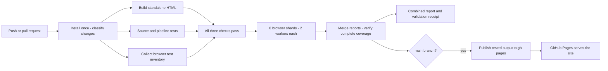

# Wedding venue planner

A static, interactive Three.js venue model. Visitors need only a browser with WebGL. There is no application server, database, paid hosting service, or runtime Node.js dependency.

The production build is a self-contained `dist/index.html` with inline HTML, CSS, JavaScript and the pinned Three.js library. It works at a GitHub Pages project URL and can also be downloaded and opened locally. Layout changes save in each visitor's own browser; they are **not shared between visitors**. Use Save layout / Load saved layout to exchange design choices.

## Local work

Use Node.js 22 or newer:

```sh
npm ci
npx playwright install chromium firefox webkit
npm test
npm run serve
```

Open the local URL printed by the server. `npm run build` alone needs no browser installation. The build uses only files in this repository and never reads your Codex installation or other wedding documents.

| File | Purpose |
| --- | --- |
| `src/model.html` | Editable venue model, controls, geometry and default design |
| `src/frame-template.html` | Standalone styles and sandbox runtime |
| `src/index-template.html` | Outer page and browser-local save/restore bridge |
| `vendor/` | Pinned Three.js 0.160.1 and its MIT license |
| `scripts/build.mjs` | Deterministic bundling, checksums and `.nojekyll` |
| `tests/` | Source/build/deployment checks and Chromium, Firefox and WebKit interaction tests |
| `src/planning.mjs` | Shared rehearsal/patio counts and furniture geometry |
| `data/venue-research.json`, `src/research.html` | Attributed photo research ledger and generated public report |
| `.circleci/config.yml` | Build, test, artifact upload and Pages publication |

Edit the source, then rebuild. Do not edit `dist/`; it is generated. The page shown in Codex and this repository are separate copies; future website changes belong in `src/model.html` and must be committed to trigger CI. The repository contains only this website, not the surrounding chat attachments or private wedding files.

## Designing the space

The Lakeside-inspired interface uses pale sage, white surfaces, fine rules, an Allura wordmark and Raleway controls. Both open-license fonts are bundled for offline use; notices and license terms are included in the HTML and build output.

The visualization is the main workspace, with camera/navigation controls beneath it and a separate design panel. Coordinated looks provide a starting palette; all individual colors and arrangements remain editable.

- **Floor plan:** capacity, dining rows/offsets, table removal, dessert and furniture positions.
- **Tables & rentals:** tablecloths, runners, napkins, flowers, candles, chairs and attributed supplier place settings.
- **Lounge & dance:** sofas, bars, dance-floor sizes, materials and supplier choices.
- **Cocktail patio:** highboys, cloth/fitted covers, grazing, guest book, welcome drinks, bar and entry displays.
- **Ceremony:** backless benches, aisle flowers, pedestals, arbors and tent concepts.
- **Wedding looks:** coordinated palettes plus photo-supported spatial concepts; unseen zones stay explicitly unverified.
- **View settings:** walls, roof, measurements, quality, lighting and house cutaway. Camera and movement stay by the render.
- **Saved designs:** six local versions, comparison summaries, undo/redo, layout JSON, PNG and a printable supplier brief.

Drag the desktop divider to resize the render/inspector. Keyboard arrows also adjust it; Enter/double-click restores the default. Saves persist across release query strings. See [the studio guide](docs/design-studio.md) for controls, estimates and the [photo research report](https://james-crowley.github.io/wedding/research.html).

Seated views offer the couple’s two positions or either side of any active guest table, with selectable seats, direction and an estimated eye height. They follow table moves/rotation and omit removed tables. Drag to look, choose Stand up here, or use WASD to leave the seat. Camera choices are saved with the layout.

Walking follows the exterior stairs onto the upper porch and main living floor while retaining ground-level access underneath. Double-tap W or ↑ within 300 ms and hold the second press to sprint at twice the selected movement speed. Release to stop sprinting; holding Shift also doubles movement speed. Esc, switching views, leaving the window and hidden tabs clear movement and sprint state. The current walking surface is included in saved camera state; older layouts remain compatible.

The wine/olive/twilight looks combine ivory flowers, wine accents, dusty-blue spires and eucalyptus. They include five bud vases with enclosed tapers or seven vases without candles; ivory and twilight variations remain editable. Hellebores, astrantia, spray roses and the mixed florist recipe are stylized geometry. Named dress-color swatches are visual approximations, not manufacturer color specifications. Opposite-corner arbor flowers offer an upper-left and lower-right arrangement.

- **Reset all:** restores the baseline layout, styling, site and camera. The confirmation offers cancellation, and **Undo reset** restores the previous design until another reset or reload.

Saved v1–v8 layouts migrate to v9. Existing seating, table positions, styling and dance floor dimensions are retained. The former unmeasured 32 × 38 ft ceremony default migrates to a more compact 28 × 34 ft estimate; custom dimensions are preserved. Public source includes the permitted venue title but contains no addresses, guest data or private photo links.

## Supplier rental choices

**Tables & rentals** and **Lounge & dance** add attributed choices from Classic Party Rentals of Virginia and Party Perfect while preserving the original custom styling controls. Search/filter products, preview supported options, and save alternatives for a rental quote. The palette records which supplier each applied product came from; manual edits remove stale matches. CSV and saved-layout JSON retain the source references. The catalog is a dated, bundled snapshot, and previews are schematic. See [catalog coverage and limitations](docs/rental-catalog.md).

## CircleCI pipeline



All branches except `gh-pages` build and test. Pull requests never publish. The publish job runs only after build/unit checks and every browser shard succeed on `main`, uses a protected context, and runs in a serial group. It checks the artifact's source commit, HTML checksum and complete browser-validation receipt, skips superseded main commits, and pushes normally without force-pushing. It refuses to replace an unrelated existing Pages site.

The Playwright package and Docker image are pinned to the same version. Browser tests block external resources and exercise real WebGL initialization, table counts, saved dimensions/bar positions, keyboard release, resizing, ceremony/tent/ceiling controls and tour navigation. Named Node test suites keep unit JUnit reports compatible with CircleCI’s results parser. Reports include per-shard JUnit and HTML reports, a combined HTML report, failure screenshots, retry traces and a successful floor-plan screenshot. Browser tests still block external resources and use real software WebGL. Each four-CPU shard uses two browser workers. Deterministic weighted test lists spread the heavier catalog batches among all eight shards; a unit check invokes Playwright against each actual list and proves every collected case is assigned exactly once. Each CI worker also validates its selected IDs before running. The expanded option matrix uses eight shards.

### Speed and change selection

- **Build once, check concurrently:** after one `npm ci`, `build-and-unit` builds the site, runs unit checks and collects browser inventory at the same time. Unit build checks use isolated temporary directories; collection does not launch browsers or read the build. All three must finish successfully before the exact output and installed dependencies are shared with browser jobs. `npm run check:static` also overlaps build and unit checks locally; `npm test` waits for both before launching browsers.
- **Cache downloads:** a versioned, architecture/Playwright/lockfile-keyed npm download cache supports `npm ci --prefer-offline`. Only the build job writes it. Installed dependencies are passed through the workflow workspace, not restored from a cross-run installed-environment cache. Browser binaries already come with the pinned Playwright image.
- **Trace on retry:** CI records a trace on the first retry instead of recording and discarding a trace for every passing first attempt. Screenshots and shard reports remain available on failure. Local full runs retain failure traces; `--trace=on` is available for explicit debugging.
- **Documentation fast path:** only `README.md` and Markdown files under `docs/` can skip browser jobs and publication. Build/unit checks still run. Main compares against the source commit recorded on `gh-pages`, covering multi-commit pushes and previously failed app builds. Other branches use their merge base with main. Missing history, failed fetching, unknown files or changes to source/tests/dependencies/CI all select the full suite. This is not a cached-test-pass bypass.
- **Balanced shards:** greedy assignment uses conservative static weights for catalog batches, option counts and stress tests. Every worker gets four or five catalog batches; unknown tests still run with a default weight. These are scheduling estimates, not cached passing results. The existing merged proof still requires every collected case and project to pass.
- **Complete gate:** merging requires a matching successful receipt from each of eight shards and passing results for every collected test/project. Missing, duplicated, skipped, failed or mismatched reports block publication. Attempt-specific report paths support workspace reuse on reruns.
- **Fast local feedback:** `npm run test:changed` inspects staged, unstaged and untracked edits. Documentation/unit-test-only edits use build/unit checks; anything else also runs all browser tests. `npm test` always runs the full suite. Playwright’s import-based `--only-changed` is deliberately not used for served HTML, which the browser specs do not import.

Parallel containers reduce elapsed time rather than the total number of browser checks. If the account queues containers, the speedup will be smaller. No build-output or passing-test-result cache is used to authorize deployment.

### Option and rendering validation

The original interaction tests are supplemented by a source-derived control inventory and a browser option matrix. Adding a new form control or dropdown choice automatically adds coverage; the runtime DOM must match that inventory. Identified buttons must belong to an exercised action workflow.

| Coverage | What runs |
| --- | --- |
| 124 form controls | Every dropdown choice; both checkbox states; numeric minima, maxima, empty and out-of-range values; black, white and accent colors for every color field |
| Generated choices | Every table toggle, furniture selection, tour stop, guest table and seat choice; valid and invalid layout-file imports |
| Palette and themes | Every coordinating swatch applied to all 11 color targets; every look card; repeated rapid theme/color/numeric bursts and reload persistence |
| Risk combinations | All 84 arbor shape/dressing/location pairs, 64 flower/arrangement pairs and 42 vase/candle pairs |
| Navigation and actions | Every identified button, responsive/light/dark layouts, walking upstairs/downstairs, double-tap/Shift sprint, release, Escape, focus loss and stale-key expiry |

Each matrix step waits for pending decor refreshes and checks a real WebGL render, console and uncaught errors, context loss, finite scene/instance/camera data and nonblank pixels. An audit self-check deliberately introduces invalid geometry and clears the canvas to prove these detectors fail. Repeated style switches must retain the existing property geometry and settle at a bounded geometry/texture count.

The large option matrix uses a smaller canvas and shadow-map resolution while retaining production geometry, materials, shaders and real software WebGL. The original interaction suite uses normal rendering quality. Reports attach the exact checked values and stress-run resource samples. Coverage is Chromium; it does not certify every GPU/browser or the full Cartesian product of every setting. Color inputs use representative extremes and accents, rather than all 16 million RGB values.

CI retries collect diagnostic traces, but a flaky result now fails the publication gate even if its retry passes. The broader matrix increases test duration; the timing comparison below describes the earlier 13-case suite.

Local full runs use two workers and a three-hour overall ceiling; CI uses one worker per shard and a 60-minute ceiling per shard. Per-case timeouts still detect stalled interactions. Use `npm run test:browser -- --workers=1` on a machine with limited memory.

### Measured workflow times

Complete CircleCI workflow times on October 28, 2026, including environment startup, reports and publication:

| Pipeline | End-to-end time | Browser coverage |
| --- | --- | --- |
| [Previous serial pipeline](https://app.circleci.com/workflow/75f8ff79-b153-4b27-a689-6fcf857e471c) | 18m 15s | All 13 cases |
| [Four shards, cached installation and concurrent static checks](https://app.circleci.com/workflow/36ccb4d0-86a8-4157-88ff-788881d1e2c8) | 7m 29s | All 13 cases, plus 16 unit checks |

That run reduced elapsed time by about 59%. Its concurrent build/unit/inventory step took 4 seconds; browser rendering remained the largest cost. These are observed runs, not guaranteed timings. The live Pages build was checked against the published manifest checksum after the workflow completed.

## First-time GitHub and CircleCI setup

The repository is connected to CircleCI. Its publisher uses a dedicated write-enabled SSH deploy key restricted to this repository, with the private key encrypted in CircleCI project settings. No personal GitHub token is needed in the pipeline. The public fingerprint is pinned in the publish job.

The `wedding-pages` context is restricted to this project, the `main` branch and jobs without SSH debugging. Forked pull requests must not receive secrets. The `gh-pages` branch is excluded from CircleCI builds to prevent a deployment loop.

To reproduce this setup in another repository:

1. Create a dedicated GitHub repository with default branch `main` and connect it to CircleCI. GitHub Free requires a public repository for Pages; private repositories require an eligible paid plan. A public Pages website remains publicly accessible even when its source repository is private.
2. Create a dedicated SSH key pair with an empty passphrase. Register the public key as a **write-enabled deploy key on this repository only**, and add the private key under **CircleCI Project Settings → SSH Keys → Additional SSH Keys**. Do not commit the key or paste it into chat.
3. Replace both public fingerprint values in `.circleci/config.yml` with the key's MD5 fingerprint. The publisher selects that exact key file and checks GitHub's host key.
4. Create a CircleCI context named **`wedding-pages`**, restrict it to this project, and add the expression restriction `pipeline.git.branch == "main" and not job.ssh.enabled`.
5. Push `main`. The first successful pipeline creates the `gh-pages` branch. An unrelated existing Pages branch causes the job to stop.
6. In GitHub **Settings → Pages**, select **Deploy from a branch**, branch **`gh-pages`**, folder **`/(root)`**. Save and enable HTTPS. GitHub shows the actual published URL there.

After this setup, successful `main` pipelines update the same share URL automatically. GitHub completes the final Pages deployment; CircleCI publishes the tested files to the source branch. Check the GitHub Pages deployment status for the live result. The CI job does not claim a URL is live merely because a Git push succeeded.

If your repository uses another default branch, change both the workflow filter and deployment guard together. If `gh-pages` has branch protection, grant the dedicated publisher the necessary access rather than weakening unrelated branches.

## CircleCI artifacts versus GitHub Pages

Use **GitHub Pages** for the lasting link you send to family and vendors. Use the CircleCI job's **Artifacts → site/index.html** for inspecting or downloading a particular build. Artifacts expire (30 days by default, also the current maximum), and private-project links may require authentication or temporary access tokens. They are not the stable public website address. CircleCI Server can additionally restrict rendering of HTML/JavaScript artifacts.

## Test commands

```sh
npm run build
npm run test:unit
npm run test:browser
npm run test:changed
circleci config validate --config .circleci/config.yml
```

Browser setup on Linux outside the supplied CI image may require `npx playwright install --with-deps chromium`. Tests use software WebGL so no physical GPU is needed. They currently cover Chromium; Safari and Firefox have not been included in the automated matrix.

## References

- [GitHub: publishing from another CI tool through gh-pages and .nojekyll](https://docs.github.com/en/pages/getting-started-with-github-pages/configuring-a-publishing-source-for-your-github-pages-site)
- [GitHub Pages availability and setup](https://docs.github.com/en/pages/getting-started-with-github-pages/creating-a-github-pages-site)
- [CircleCI artifact storage and retention](https://circleci.com/docs/guides/optimize/artifacts/)
- [CircleCI artifact access permissions](https://circleci.zendesk.com/hc/en-us/articles/360057122012-Can-External-Non-Authenticated-Users-Access-my-Artifacts-with-the-URL)
- [CircleCI serial groups and configuration](https://circleci.com/docs/reference/configuration-reference/)
- [Playwright test lists](https://playwright.dev/docs/test-cli#test-list)
- [Playwright test sharding](https://playwright.dev/docs/test-sharding)
- [CircleCI npm caching](https://circleci.com/docs/guides/optimize/caching/)
- [Playwright on CircleCI](https://playwright.dev/docs/ci#circleci)

The venue geometry, power locations, furniture footprints and clearance guides retain their planning-estimate limitations. This is a visualization, not a surveyed plan or venue-approved accessibility/egress design.
